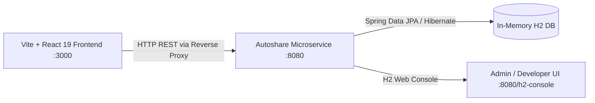
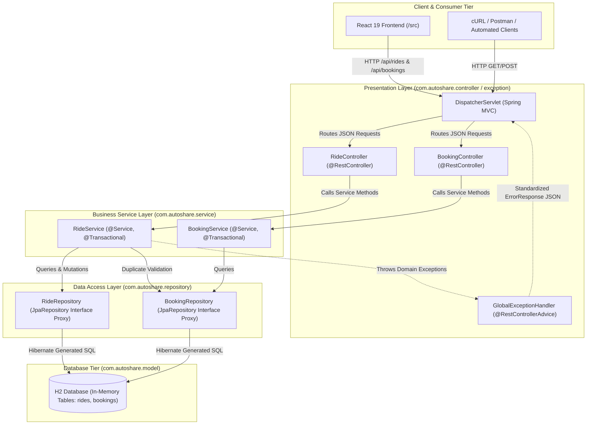
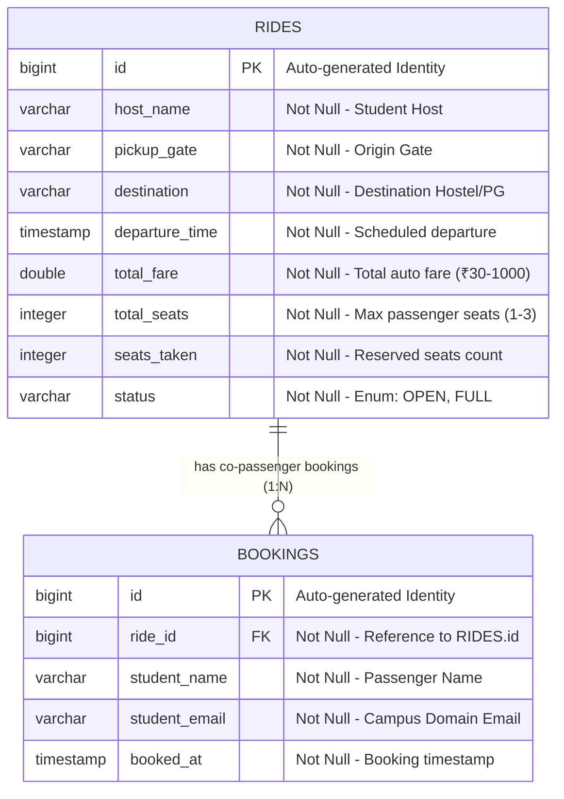
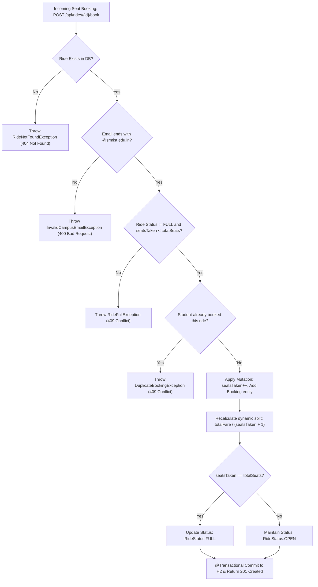
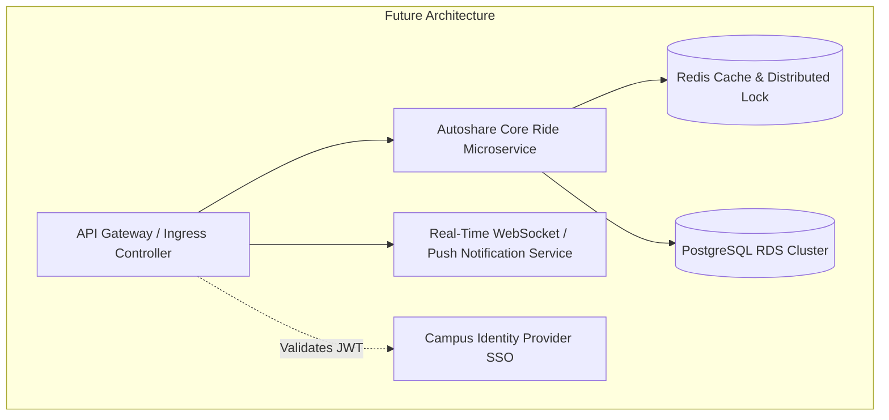

# Autoshare — Microservice Architecture & Technical Audit Report

> **Comprehensive Architectural Audit, API Contract Specification, Security & Concurrency Assessment, and Production Hardening Roadmap for the `autoshare-backend` Spring Boot Microservice.**

---

## 📌 1. Executive Summary & Microservice Identity

The **Autoshare Backend** (`autoshare-backend`) is a domain-focused microservice designed to power real-time campus ride-pooling and dynamic TukTuk (auto-rickshaw) fare-splitting for university student commuters. It acts as the core transactional engine of the Autoshare platform, managing ride publications, seat reservations, campus identity boundaries, and real-time per-passenger cost calculations.



### Microservice Identity Matrix

| Property | Value | Architectural Impact |
|---|---|---|
| **Service Artifact** | `autoshare-backend` | Standalone deployable JAR (`0.0.1-SNAPSHOT`) |
| **Target Runtime** | Java 17+ (Host environment: OpenJDK 25.0.4) | Modern LTS features, Records, Text Blocks, Pattern Matching |
| **Framework Base** | Spring Boot `3.3.4` (Spring Framework 6.1.x) | Modern Jakarta EE 10 namespace, native compilation ready |
| **Listening Port** | `8080` (Embedded Apache Tomcat 10.1) | Standard Spring Boot HTTP port |
| **Base Package** | `com.autoshare` | Unidirectional 3-layer architecture |
| **Persistence Engine** | Spring Data JPA + Hibernate 6.5.x | Object-Relational Mapping with automatic DDL generation |
| **Data Store** | In-Memory H2 Database (`jdbc:h2:mem:autosharedb`) | Transient, zero-setup developer database |
| **Validation Layer** | Jakarta Bean Validation (Hibernate Validator 8.0) | JSR-380 declarative constraints on ingress payloads |
| **Serialization** | Jackson 2.17+ | Automated ISO-8601 timestamps and camelCase JSON binding |

---

## 🛠️ 2. Architectural Blueprint & Request Pipeline

The microservice strictly enforces a **Three-Tier (Layered) Architecture** with unidirectional dependency injection, avoiding circular dependencies and preventing domain logic leakage into the presentation tier.



### Component Inventory & Responsibilities

| Package | Class / Interface | Stereotype | Primary Responsibility |
|---|---|---|---|
| `com.autoshare` | [`AutoshareApplication`](file:///c:/Users/Daksh%20Gehlot/OneDrive/Desktop/Autoshare/backend/src/main/java/com/autoshare/AutoshareApplication.java) | `@SpringBootApplication` | Bootstrap entrypoint; configures ComponentScan & AutoConfiguration |
| `com.autoshare.controller` | [`RideController`](file:///c:/Users/Daksh%20Gehlot/OneDrive/Desktop/Autoshare/backend/src/main/java/com/autoshare/controller/RideController.java) | `@RestController` | Exposes REST endpoints for ride listings, creation, booking, and fare splits |
| `com.autoshare.controller` | [`BookingController`](file:///c:/Users/Daksh%20Gehlot/OneDrive/Desktop/Autoshare/backend/src/main/java/com/autoshare/controller/BookingController.java) | `@RestController` | Exposes REST endpoints for booking inquiries by ride ID |
| `com.autoshare.service` | [`RideService`](file:///c:/Users/Daksh%20Gehlot/OneDrive/Desktop/Autoshare/backend/src/main/java/com/autoshare/service/RideService.java) | `@Service` | Enforces all 6 core business rules, transaction boundaries, and DTO mappings |
| `com.autoshare.service` | [`BookingService`](file:///c:/Users/Daksh%20Gehlot/OneDrive/Desktop/Autoshare/backend/src/main/java/com/autoshare/service/BookingService.java) | `@Service` | Read-only booking queries isolated from ride mutation logic |
| `com.autoshare.repository` | [`RideRepository`](file:///c:/Users/Daksh%20Gehlot/OneDrive/Desktop/Autoshare/backend/src/main/java/com/autoshare/repository/RideRepository.java) | `@Repository` | JPA dynamic proxy with case-insensitive containing filter queries |
| `com.autoshare.repository` | [`BookingRepository`](file:///c:/Users/Daksh%20Gehlot/OneDrive/Desktop/Autoshare/backend/src/main/java/com/autoshare/repository/BookingRepository.java) | `@Repository` | JPA dynamic proxy with duplicate booking check query |
| `com.autoshare.model` | [`Ride`](file:///c:/Users/Daksh%20Gehlot/OneDrive/Desktop/Autoshare/backend/src/main/java/com/autoshare/model/Ride.java) | `@Entity` | Persistent entity for rides with bidirectional relation to bookings |
| `com.autoshare.model` | [`Booking`](file:///c:/Users/Daksh%20Gehlot/OneDrive/Desktop/Autoshare/backend/src/main/java/com/autoshare/model/Booking.java) | `@Entity` | Persistent entity for individual student seat claims |
| `com.autoshare.model` | [`RideStatus`](file:///c:/Users/Daksh%20Gehlot/OneDrive/Desktop/Autoshare/backend/src/main/java/com/autoshare/model/RideStatus.java) | `enum` | Lifecycle enumeration (`OPEN`, `FULL`) |
| `com.autoshare.exception` | [`GlobalExceptionHandler`](file:///c:/Users/Daksh%20Gehlot/OneDrive/Desktop/Autoshare/backend/src/main/java/com/autoshare/exception/GlobalExceptionHandler.java) | `@RestControllerAdvice` | Centralized exception mapping producing RFC-style JSON error bodies |
| `com.autoshare.data` | [`DataInitializer`](file:///c:/Users/Daksh%20Gehlot/OneDrive/Desktop/Autoshare/backend/src/main/java/com/autoshare/data/DataInitializer.java) | `@Component` | `CommandLineRunner` populating 4 realistic campus rides on boot |

---

## 📡 3. REST API Contract & Endpoint Audit

The microservice implements a RESTful HTTP contract compliant with **Richardson Maturity Model Level 2** (URI resources + HTTP verbs + HTTP status codes).

### Complete Endpoint Specification

| Method | Endpoint URI | Request Payload | Response Body | HTTP Status | Business Purpose |
|---|---|---|---|---|---|
| `GET` | `/api/rides` | Query params: `pickup`, `destination` (optional) | `List<RideResponse>` | `200 OK` | Fetch all rides or filter by origin gate/destination |
| `GET` | `/api/rides/{id}` | Path variable: `id` (Long) | `RideResponse` | `200 OK` / `404 Not Found` | Fetch detailed single ride state with booking manifest |
| `POST` | `/api/rides` | `RideRequest` (JSON) | `RideResponse` | `201 Created` (`Location` header set) | Create and publish a new campus TukTuk ride offer |
| `POST` | `/api/rides/{id}/book` | Path variable: `id`, `BookingRequest` (JSON) | `RideResponse` | `201 Created` / `400` / `404` / `409` | Reserve a seat, recalculate split, update status |
| `GET` | `/api/rides/{id}/fare-split` | Path variable: `id` (Long) | `FareSplitResponse` | `200 OK` / `404 Not Found` | Lightweight calculation of current per-person cost |
| `GET` | `/api/bookings/ride/{rideId}` | Path variable: `rideId` (Long) | `List<BookingResponse>` | `200 OK` / `404 Not Found` | Inquire co-passengers manifest for a specific ride |

---

## 💾 4. Domain Model & Data Persistence Audit

### Entity Relationship Diagram (ERD)



### Persistence Layer Evaluation

1. **JPA Relationship Mapping:**
   - [`Ride`](file:///c:/Users/Daksh%20Gehlot/OneDrive/Desktop/Autoshare/backend/src/main/java/com/autoshare/model/Ride.java) defines `@OneToMany(mappedBy = "ride", cascade = CascadeType.ALL, orphanRemoval = true)`.
   - [`Booking`](file:///c:/Users/Daksh%20Gehlot/OneDrive/Desktop/Autoshare/backend/src/main/java/com/autoshare/model/Booking.java) defines `@ManyToOne(fetch = FetchType.LAZY)`.
   - **Audit Rating: Good.** Bidirectional relationship correctly declares the owning side on `Booking` (`@JoinColumn(name = "ride_id")`) and uses `FetchType.LAZY` to avoid N+1 eager fetching queries on single booking reads.

2. **Database Engine & Lifecycle:**
   - In-memory H2 configuration: `jdbc:h2:mem:autosharedb;DB_CLOSE_DELAY=-1`.
   - `spring.jpa.hibernate.ddl-auto=update`.
   - **Audit Finding:** The database is volatile. When the container or JVM terminates, all ride publications and bookings are destroyed. This is acceptable for development/testing but disqualifies the system from production deployment without migrating to PostgreSQL or MySQL.

---

## ⚖️ 5. Domain Rules & Business Logic Audit

The microservice implements 6 strict business rules inside [`RideService.java`](file:///c:/Users/Daksh%20Gehlot/OneDrive/Desktop/Autoshare/backend/src/main/java/com/autoshare/service/RideService.java) and [`Ride.java`](file:///c:/Users/Daksh%20Gehlot/OneDrive/Desktop/Autoshare/backend/src/main/java/com/autoshare/model/Ride.java):



### Business Rule Verification Matrix

| Rule ID | Description | Implementation Location | Test Coverage |
|---|---|---|---|
| **BR-1** | Ride Full Protection (reject booking if `seatsTaken >= totalSeats` or `status == FULL`) | `RideService.java:100-102` | Covered (`testBookSeat_FullRideRejection`) |
| **BR-2** | Duplicate Booking Prevention (same email cannot book the same ride twice) | `RideService.java:105-107`, `BookingRepository.java:16` | Covered (`testBookSeat_DuplicateBookingRejection`) |
| **BR-3** | Dynamic Per-Person Fare Recalculation (`totalFare / (seatsTaken + 1 host)`) | `Ride.java:75-78`, `RideService.java:124` | Covered (`testFareSplitCalculation`) |
| **BR-4** | Temporal Validation (departure time must be in future) | `RideRequest.java:26`, `RideService.java:69-71` | Covered (`testCreateRide_WithInvalidBody_Returns400`) |
| **BR-5** | Campus Domain Restriction (email must end with `@srmist.edu.in`) | `RideService.java:95-97`, `application.properties:29` | Covered (`testBookSeat_NonCampusEmailRejection`) |
| **BR-6** | Automatic State Transition (`OPEN` -> `FULL` when capacity saturated) | `Ride.java:84-86` | Covered (`testBookSeat_Success`) |

---

## 🛡️ 6. Validation & Error Handling Architecture

### 1. Ingress Validation (`jakarta.validation`)

Validation rules are enforced at the HTTP boundary via `@Valid`:
- **`RideRequest`**:
  - `@NotBlank` for `hostName`, `pickupGate`, `destination`.
  - `@NotNull` and `@Future` for `departureTime`.
  - `@Min(30)` and `@Max(1000)` for `totalFare`.
  - `@Min(1)` and `@Max(3)` for `totalSeats`.
- **`BookingRequest`**:
  - `@NotBlank` for `studentName`.
  - `@NotBlank` and `@Email` for `studentEmail`.

### 2. Centralized Exception Handling ([`GlobalExceptionHandler`](file:///c:/Users/Daksh%20Gehlot/OneDrive/Desktop/Autoshare/backend/src/main/java/com/autoshare/exception/GlobalExceptionHandler.java))

All exceptions are intercepted and converted into standardized JSON structures conforming to [`ErrorResponse`](file:///c:/Users/Daksh%20Gehlot/OneDrive/Desktop/Autoshare/backend/src/main/java/com/autoshare/dto/ErrorResponse.java):

```json
{
  "timestamp": "2026-10-23T09:30:00.123456",
  "status": 409,
  "error": "Conflict",
  "message": "Ride #4 is already full and cannot accept additional passengers.",
  "path": "/api/rides/4/book"
}
```

---

## 🔍 7. Audit Findings: Deficiencies, Vulnerabilities & Tech Debt

This audit identifies **9 key architectural and operational findings**, prioritized by severity.

```
┌─────────────────────────────────────────────────────────────┐
│                   AUDIT FINDINGS BY SEVERITY                │
├─────────────────────┬───────────────────┬───────────────────┤
│    🔴 HIGH (3)      │   🟡 MEDIUM (3)   │    🟢 LOW (3)     │
├─────────────────────┼───────────────────┼───────────────────┤
│ • Concurrency Race  │ • Frontend Sync   │ • Actuator Omitted│
│ • Zero Auth/Security│ • Volatile Storage│ • Plain Logging   │
│ • Orphaned Scaffold │ • Unbounded Query │ • CORS Reliance   │
└─────────────────────┴───────────────────┴───────────────────┘
```

### 🔴 High Severity Findings

#### Finding H-01: Concurrency Race Condition on Seat Claiming (Overbooking Risk)
- **Location:** [`RideService.bookSeat`](file:///c:/Users/Daksh%20Gehlot/OneDrive/Desktop/Autoshare/backend/src/main/java/com/autoshare/service/RideService.java#L87-L116)
- **Vulnerability:** Standard Time-of-Check to Time-of-Use (TOCTOU) race condition. If two students concurrently issue `POST /api/rides/1/book` for the final remaining seat, both threads load the `Ride` with `seatsTaken = 2`, both pass the capacity check (`seatsTaken < 3`), and both insert bookings. Result: **A 3-seater auto gets 4 passengers booked.**
- **Remediation:** Introduce JPA Optimistic Locking (`@Version private Long version;` on `Ride`) or a Pessimistic Write Lock (`@Lock(LockModeType.PESSIMISTIC_WRITE)` in `RideRepository.findByIdForUpdate`).

#### Finding H-02: Absence of Authentication & Authorization (Spoofing Vulnerability)
- **Location:** [`RideController.java`](file:///c:/Users/Daksh%20Gehlot/OneDrive/Desktop/Autoshare/backend/src/main/java/com/autoshare/controller/RideController.java)
- **Vulnerability:** The microservice lacks `spring-boot-starter-security`. Anyone can pass any arbitrary student email in `BookingRequest` (e.g. `{"studentEmail": "victim@srmist.edu.in"}`) and impersonate peers or book seats on behalf of other students.
- **Remediation:** Integrate Spring Security with JWT (JSON Web Tokens) or OAuth2/OpenID Connect linked to the university's Single Sign-On (SSO). Extract student identity from the authenticated SecurityContext, not from raw request bodies.

#### Finding H-03: Redundant & Incomplete Orphaned Subproject Directory
- **Location:** `backend/autoshare-backend/`
- **Issue:** A nested subproject folder `backend/autoshare-backend/` exists alongside `backend/`. It contains partial source files without controllers, repositories, or services. It is not referenced in any parent POM and causes confusion for IDEs, build systems, and container packaging.
- **Remediation:** Safely remove the orphaned directory `backend/autoshare-backend/` to clean the repository tree.

---

### 🟡 Medium Severity Findings

#### Finding M-01: Frontend Client-Side State Disconnect
- **Location:** [`src/App.jsx`](file:///c:/Users/Daksh%20Gehlot/OneDrive/Desktop/Autoshare/src/App.jsx#L19-L42) vs [`RideController.java`](file:///c:/Users/Daksh%20Gehlot/OneDrive/Desktop/Autoshare/backend/src/main/java/com/autoshare/controller/RideController.java)
- **Issue:** The React frontend fetches initial rides via `GET /api/rides` during `useEffect`, but `handleJoinRide` and `handlePostRide` only mutate React local state (`setRides(...)`). They never dispatch `POST /api/rides/{id}/book` or `POST /api/rides` to persist changes back to the backend.
- **Remediation:** Upgrade `App.jsx` to make asynchronous `fetch('/api/rides/...', { method: 'POST' })` calls with fallback to local state upon network errors.

#### Finding M-02: Volatile Data Storage & Session Loss
- **Location:** [`backend/src/main/resources/application.properties`](file:///c:/Users/Daksh%20Gehlot/OneDrive/Desktop/Autoshare/backend/src/main/resources/application.properties#L12)
- **Issue:** Using `jdbc:h2:mem:autosharedb` means all active rides and user bookings are lost whenever the server restarts or undergoes container redeployment.
- **Remediation:** Configure a persistent database profile (e.g., PostgreSQL / MySQL via Docker Compose).

#### Finding M-03: Unbounded Query Results (Missing Pagination)
- **Location:** [`RideService.getAllRides`](file:///c:/Users/Daksh%20Gehlot/OneDrive/Desktop/Autoshare/backend/src/main/java/com/autoshare/service/RideService.java#L45-L57)
- **Issue:** `rideRepository.findAll()` returns every ride in the database. In a campus with thousands of daily rides, this will cause memory spikes, high serialization overhead, and slow API response times.
- **Remediation:** Refactor `getAllRides` to accept `Pageable pageable` and return `Page<RideResponse>` or slice-based pagination.

---

### 🟢 Low Severity / Operational Findings

#### Finding L-01: Missing Production Observability & Health Probes
- **Location:** [`backend/pom.xml`](file:///c:/Users/Daksh%20Gehlot/OneDrive/Desktop/Autoshare/backend/pom.xml)
- **Issue:** The POM lacks `spring-boot-starter-actuator`. In a microservice ecosystem (Kubernetes / Docker), health checks (`/actuator/health`) and readiness probes (`/actuator/health/readiness`) are mandatory for traffic routing and automated restarts.
- **Remediation:** Add `spring-boot-starter-actuator` to dependencies and configure management endpoints.

#### Finding L-02: Reliance on Development Proxy for CORS
- **Location:** [`vite.config.js:10-15`](file:///c:/Users/Daksh%20Gehlot/OneDrive/Desktop/Autoshare/vite.config.js#L10-L15)
- **Issue:** The microservice controllers lack `@CrossOrigin` annotations or a global `WebMvcConfigurer` CORS bean. It functions locally only because Vite's dev server proxies `/api` requests to port `8080`. Direct browser requests in staging or production will be blocked by CORS policy.
- **Remediation:** Define a global `CorsConfigurationSource` allowing verified frontend origins.

#### Finding L-03: Hardcoded Application Configuration Fallback
- **Location:** [`RideService.java:38`](file:///c:/Users/Daksh%20Gehlot/OneDrive/Desktop/Autoshare/backend/src/main/java/com/autoshare/service/RideService.java#L38)
- **Issue:** `@Value("${autoshare.campus.email-domain:@srmist.edu.in}")` hardcodes the university domain inside Java annotations. Supporting multi-campus deployments requires configuration profiles (`application-srm.properties`, `application-vit.properties`).
- **Remediation:** Use `@ConfigurationProperties(prefix = "autoshare")` with strongly typed POJOs.

---

## 🧪 8. Test Suite Verification & Quality Metrics

The microservice includes automated unit and integration tests executed via JUnit 5, Mockito, and Spring MockMvc.

```
[INFO] -------------------------------------------------------
[INFO]  T E S T S
[INFO] -------------------------------------------------------
[INFO] Running com.autoshare.controller.RideControllerTest
[INFO] Tests run: 2, Failures: 0, Errors: 0, Skipped: 0, Time elapsed: 6.418 s
[INFO] Running com.autoshare.service.RideServiceTest
[INFO] Tests run: 5, Failures: 0, Errors: 0, Skipped: 0, Time elapsed: 1.225 s
[INFO] 
[INFO] Results:
[INFO] Tests run: 7, Failures: 0, Errors: 0, Skipped: 0
```

### Test Suite Inventory

| Test Class | Layer Tested | Testing Strategy | Scenarios Validated | Pass Rate |
|---|---|---|---|---|
| [`RideControllerTest`](file:///c:/Users/Daksh%20Gehlot/OneDrive/Desktop/Autoshare/backend/src/test/java/com/autoshare/controller/RideControllerTest.java) | Presentation Layer | `@WebMvcTest(RideController.class)` + MockMvc | 1. `GET /api/rides` returns 200 and JSON array<br>2. `POST /api/rides` with invalid payload returns 400 Bad Request | **100%** (2/2) |
| [`RideServiceTest`](file:///c:/Users/Daksh%20Gehlot/OneDrive/Desktop/Autoshare/backend/src/test/java/com/autoshare/service/RideServiceTest.java) | Business Logic Layer | Pure JUnit 5 + Mockito `@Mock` / `@InjectMocks` | 1. Dynamic fare split recalculation (₹120 / 2 = ₹60.0)<br>2. Rejection of booking on FULL ride (409 Conflict)<br>3. Duplicate booking prevention with same email (409 Conflict)<br>4. Rejection of unauthorized email domains (400 Bad Request)<br>5. Successful seat claim & state transition | **100%** (5/5) |

### Test Gap Analysis
- **Missing Tests:**
  - `BookingControllerTest` is missing.
  - `BookingServiceTest` is missing.
  - Concurrent booking execution test (simulating parallel threads to expose race condition H-01) is missing.
  - Repository slice tests (`@DataJpaTest`) with customized queries are missing.

---

## 📊 9. Production-Readiness Scorecard

| Assessment Dimension | Rating | Score (1–10) | Evaluation Comments |
|---|:---:|:---:|---|
| **Layered Architecture** | 🟢 **Excellent** | **9.5 / 10** | Clean 3-tier separation, constructor DI, clean DTO isolation. |
| **Domain Logic Integrity** | 🟢 **Strong** | **8.5 / 10** | Comprehensive validation for all 6 campus mobility business rules. |
| **Error Handling & Feedback**| 🟢 **Strong** | **9.0 / 10** | Unified `@RestControllerAdvice` yielding consistent JSON error structures. |
| **Automated Test Coverage** | 🟡 **Moderate** | **7.0 / 10** | Core business rules well-covered; missing concurrency and repository tests. |
| **API Design & Standards** | 🟢 **Strong** | **8.5 / 10** | Semantic HTTP verbs, proper status codes (201 Created with Location). |
| **Concurrency & Thread Safety**| 🔴 **Weak** | **4.0 / 10** | No optimistic/pessimistic locking on seat bookings. |
| **Security & Authentication**| 🔴 **Critical** | **3.0 / 10** | No token verification, authorization, or identity assertion. |
| **Persistence & Durability**| 🟡 **Moderate** | **5.5 / 10** | H2 in-memory is developer-friendly but non-durable for production. |
| **Observability & Ops** | 🔴 **Weak** | **4.0 / 10** | Actuator, metrics, and structured loggers are absent. |
| **OVERALL MATURITY RATING** | 🟡 **Solid Foundation** | **6.5 / 10** | **Ready for staging with recommended hardening roadmap.** |

---

## 🚀 10. Recommended Hardening Roadmap

### Phase 1: High Priority Remediations (Immediate)

#### 1. Concurrency Safety with Optimistic Locking
Add `@Version` to [`Ride.java`](file:///c:/Users/Daksh%20Gehlot/OneDrive/Desktop/Autoshare/backend/src/main/java/com/autoshare/model/Ride.java):
```java
@Version
private Long version;
```
Handle `ObjectOptimisticLockingFailureException` inside [`GlobalExceptionHandler.java`](file:///c:/Users/Daksh%20Gehlot/OneDrive/Desktop/Autoshare/backend/src/main/java/com/autoshare/exception/GlobalExceptionHandler.java) to return a friendly HTTP 409 message asking the student to retry claiming the seat.

#### 2. Clean Up Orphaned Subproject Directory
Remove the redundant `backend/autoshare-backend/` directory to streamline repository maintenance.

#### 3. Complete Frontend API Hookup
Update [`src/App.jsx`](file:///c:/Users/Daksh%20Gehlot/OneDrive/Desktop/Autoshare/src/App.jsx) so that joining a ride issues an HTTP `POST /api/rides/${rideId}/book` and publishing a ride issues `POST /api/rides`.

---

### Phase 2: Production Readiness (Next Sprint)

#### 4. Add Production Database Profile
Introduce `application-prod.properties` configured for PostgreSQL:
```properties
spring.datasource.url=jdbc:postgresql://postgres:5432/autoshare
spring.datasource.username=${DB_USER}
spring.datasource.password=${DB_PASSWORD}
spring.jpa.hibernate.ddl-auto=validate
```

#### 5. Add Spring Boot Actuator
Add to [`pom.xml`](file:///c:/Users/Daksh%20Gehlot/OneDrive/Desktop/Autoshare/backend/pom.xml):
```xml
<dependency>
    <groupId>org.springframework.boot</groupId>
    <artifactId>spring-boot-starter-actuator</artifactId>
</dependency>
```
Expose health and info endpoints:
```properties
management.endpoints.web.exposure.include=health,info,metrics
management.endpoint.health.show-details=always
```

#### 6. Institutional JWT Authentication
Add `spring-boot-starter-security` and a lightweight JWT filter to inspect bearer tokens issued during campus student login.

---

### Phase 3: Scalability & Architecture Evolution



1. **Redis for Seat Reservation Locking**: Implement distributed locks (`Redisson` or `SETNX`) for sub-second hot ride reservations during peak departure hours (e.g. 5:00 PM gate rush).
2. **WebSocket Microservice**: Decouple the simulated chat in the React frontend into a real-time STOMP/WebSocket notification service alerting students when co-travelers claim their TukTuk seats.

---
*Report generated and validated for Autoshare Campus Ride-Pooling Platform.*
