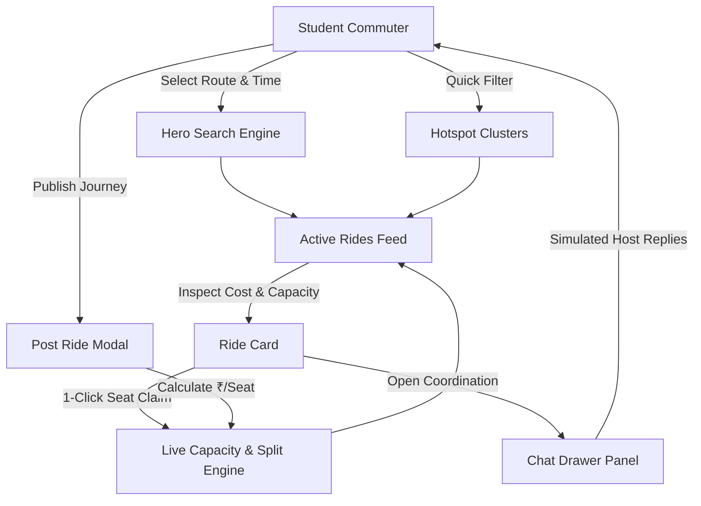
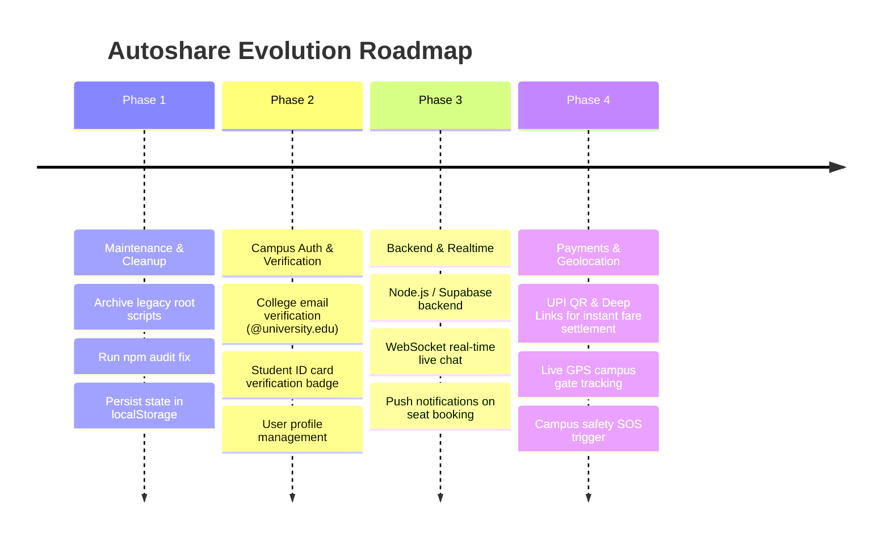

# Autoshare — Project Summary & Technical Audit Report

> **Comprehensive project audit, architectural review, feature matrix, code health assessment, and production readiness roadmap for Autoshare.**

---

## 📌 Executive Summary

**Autoshare** is a specialized campus mobility and ride-pooling web platform engineered to solve daily commuting friction for university students. By pairing students traveling to identical hostel clusters, PG zones, and apartments from campus gates, the platform divides TukTuk (auto-rickshaw) fares dynamically, slashes individual transport costs by 50%–70%, decreases gate congestion, and improves student travel safety through group coordination.

The project originated as a vanilla HTML5/CSS3/JavaScript prototype and has matured into a production-grade single-page application (SPA) powered by **React 19** and **Vite 6**, complete with an accessible design system, live split calculators, reactive group coordination chat, and responsive mobile-first interfaces.



---

## 🛠️ Technology Stack & System Architecture

### 1. Technology Matrix

| Layer | Technology | Version | Purpose / Functionality |
|---|---|---|---|
| **UI Framework** | React | `^19.0.0` | Component-based reactive UI rendering, state management |
| **DOM Engine** | React DOM | `^19.0.0` | Virtual DOM reconciliation and browser mounting |
| **Build & Dev Tool** | Vite | `^6.2.0` | Ultra-fast HMR, bundling, ES modules dev server |
| **Babel/SWC Plugin** | `@vitejs/plugin-react` | `^4.3.4` | Fast JSX transformation and React Fast Refresh |
| **Iconography** | Lucide React | `^1.16.0` | Feather-based lightweight, accessible SVG icon components |
| **Typography** | Google Fonts | CDN | *Outfit* (Headings, 400-800) & *Plus Jakarta Sans* (Body, 400-700) |
| **Styling** | Vanilla CSS3 | Custom Design System | Modular design tokens, HSL palette, CSS Grid, Flexbox, Glassmorphism |
| **Runtime Target** | Modern Browsers | ES2022+ | Native ES modules, CSS variables, backdrop-filter |

---

### 2. Dual-Architecture State (Evolution History)

The repository currently contains two parallel implementations reflecting its developmental progression:

1. **Legacy Prototype (`/app.js`, `/style.css`, raw DOM scripts in git history):**
   - Imperative DOM manipulation via `document.getElementById` and `innerHTML` template strings.
   - Global mutable variables (`ridesData`, `activeChatRideId`).
   - Directly loaded Lucide CDN script.
2. **Current Production Architecture (`/src/**`):**
   - Declarative component hierarchy governed by idiomatic React hooks (`useState`, `useMemo`, `useEffect`, `useRef`).
   - Strictly typed props passing and immutable state updates (`prev => prev.map(...)`).
   - Scoped design tokens and CSS variables in [`src/styles/index.css`](file:///c:/Users/Daksh%20Gehlot/OneDrive/Desktop/Autoshare/src/styles/index.css).
   - Component isolation with zero leaky DOM side effects.

---

## 📂 Codebase Inventory & Directory Structure

```
Autoshare/
├── docs/                                          # Project Technical Documentation
│   ├── javascript-tags-and-methods-report.md      # One-line explanation of JS keywords, APIs & events
│   ├── react-components-and-tags-report.md        # Comprehensive catalog of React & JSX tags
│   ├── tags-and-properties-report.md              # HTML tags and CSS properties reference
│   └── project-summary-audit.md                   # [This Audit Report] Master project summary
├── src/                                           # Modern React 19 Application Source
│   ├── components/                                # Reusable UI Components
│   │   ├── ChatDrawer.jsx                         # Real-time slide-over group coordination chat
│   │   ├── Footer.jsx                             # Campus safety guidelines & copyright
│   │   ├── HeroSearch.jsx                         # Multi-criteria route & time search banner
│   │   ├── HotspotClusters.jsx                    # Top PG/Hostel destination fast-filter cards
│   │   ├── Navbar.jsx                             # Sticky navigation bar with "Post a Ride" CTA
│   │   ├── PostRideModal.jsx                      # Accessible modal dialog with split estimator
│   │   ├── RideCard.jsx                           # Rich ride offer card with capacity indicator
│   │   ├── RidesFeed.jsx                          # Feed container with empty-state handling
│   │   ├── SidebarStats.jsx                       # Live campus savings and daily group stats
│   │   └── Toast.jsx                              # Animated feedback alert component
│   ├── data/
│   │   └── mockRides.js                           # Initial seed data for rides, chats & hotspots
│   ├── styles/
│   │   └── index.css                              # Comprehensive design system tokens & classes
│   ├── App.jsx                                    # Global application state orchestrator
│   └── main.jsx                                   # React 19 entry point and DOM root mounter
├── dist/                                          # Production Build Output (Vite)
│   ├── assets/
│   │   ├── index-*.css                            # Optimized production CSS bundle (16.87 kB)
│   │   └── index-*.js                             # Minified vendor + app JavaScript (255.70 kB)
│   └── index.html                                 # Bundled HTML shell
├── app.js                                         # Legacy prototype script (reference)
├── style.css                                      # Legacy prototype stylesheet (reference)
├── index.html                                     # Root HTML template with Google Fonts & metadata
├── vite.config.js                                 # Vite bundler & React plugin configuration
├── package.json                                   # NPM project manifest & scripts
└── README.md                                      # Project introductory documentation
```

---

## 🧩 Component & Feature Matrix

| Component | LOC | Primary Hooks | Role & User Capabilities |
|---|---|---|---|
| [`App.jsx`](file:///c:/Users/Daksh%20Gehlot/OneDrive/Desktop/Autoshare/src/App.jsx) | 271 | `useState`, `useMemo` | Central state coordinator. Manages rides array, filter criteria, active chat channel, modal visibility, and toast dispatches. |
| [`Navbar.jsx`](file:///c:/Users/Daksh%20Gehlot/OneDrive/Desktop/Autoshare/src/components/Navbar.jsx) | 26 | *Stateless* | Sticky header with branded logo (`🛺 Autoshare`), anchor links (`#how-it-works`, `#active-rides`), and the primary modal launcher. |
| [`HeroSearch.jsx`](file:///c:/Users/Daksh%20Gehlot/OneDrive/Desktop/Autoshare/src/components/HeroSearch.jsx) | 97 | *Stateless Controlled* | Triple-criteria search console (Pickup gate dropdown, destination text query, departure time window) with submit dispatch. |
| [`RidesFeed.jsx`](file:///c:/Users/Daksh%20Gehlot/OneDrive/Desktop/Autoshare/src/components/RidesFeed.jsx) | 63 | *Stateless* | Live feed container rendering ride offer count, list of `<RideCard />` elements, and a fallback empty state with reset trigger. |
| [`RideCard.jsx`](file:///c:/Users/Daksh%20Gehlot/OneDrive/Desktop/Autoshare/src/components/RideCard.jsx) | 148 | *Stateless Controlled* | Displays host badge, route path, departure time, dynamic ₹/student split calculation, visual capacity dots, and join/chat actions. |
| [`SidebarStats.jsx`](file:///c:/Users/Daksh%20Gehlot/OneDrive/Desktop/Autoshare/src/components/SidebarStats.jsx) | 26 | *Stateless* | Metric widget highlighting active campus groups (live counter), estimated student savings (₹45–₹60), and peak pickup points. |
| [`HotspotClusters.jsx`](file:///c:/Users/Daksh%20Gehlot/OneDrive/Desktop/Autoshare/src/components/HotspotClusters.jsx) | 30 | *Stateless* | Fast-selection modules for popular student destinations (Starlight Hostels, Green Meadows, R.K. Puram, Royal Residency). |
| [`PostRideModal.jsx`](file:///c:/Users/Daksh%20Gehlot/OneDrive/Desktop/Autoshare/src/components/PostRideModal.jsx) | 178 | `useState`, `useEffect` | Accessible popup form with escape-key dismissal, interactive 1–3 seat buttons, live per-student cost calculation, and input sanitization. |
| [`ChatDrawer.jsx`](file:///c:/Users/Daksh%20Gehlot/OneDrive/Desktop/Autoshare/src/components/ChatDrawer.jsx) | 144 | `useState`, `useEffect`, `useRef` | Slide-in group coordination drawer with floating trigger, message history, auto-scrolling to newest message, and host auto-replies. |
| [`Toast.jsx`](file:///c:/Users/Daksh%20Gehlot/OneDrive/Desktop/Autoshare/src/components/Toast.jsx) | 18 | *Stateless* | Non-blocking visual notification pill displaying status confirmation upon joining a ride or publishing an offer. |
| [`Footer.jsx`](file:///c:/Users/Daksh%20Gehlot/OneDrive/Desktop/Autoshare/src/components/Footer.jsx) | 12 | *Stateless* | Semantic footer displaying dynamic copyright year and student safety travel advisory. |

---

## 🎨 Design System & Aesthetic Tokens

The application features a modern dark-mode aesthetic with warm amber/gold accents evoking the classic Indian auto-rickshaw palette.

```
Primary Accent (Auto Rickshaw Gold):  #F59E0B (hsl(38, 92%, 50%))
Background Canvas (Deep Slate):       #0F172A (hsl(222, 47%, 11%))
Card Surface (Layered Obsidian):      #1E293B (hsl(217, 33%, 17%))
Card Elevated / Inputs:               #334155 (hsl(215, 25%, 27%))
Typography Primary:                   #F8FAFC (hsl(210, 40%, 98%))
Typography Secondary / Muted:         #94A3B8 (hsl(215, 16%, 65%))
Success Indicator:                    #10B981 (hsl(158, 64%, 40%))
Border & Dividers:                    rgba(255, 255, 255, 0.08)
```

### Key UI Capabilities
- **Glassmorphism:** Sticky navigation and modal backdrops utilize `backdrop-filter: blur(12px)`.
- **Micro-Animations:** Smooth hover elevation (`translateY(-2px)`), card glow effects, and spring transitions on drawer sliding.
- **Seat Capacity Visualization:** Distinct dot indicators (`.seat-dot.taken`) indicating real-time occupancy.

---

## 📊 Build, Performance & Quality Audit

### 1. Build Compilation Test

Executing `npm run build` with Vite 6.4.3:
```
vite v6.4.3 building for production...
transforming...
✓ 1902 modules transformed.
rendering chunks...
computing gzip size...
dist/index.html                   1.06 kB │ gzip:  0.62 kB
dist/assets/index-Czs6VO4L.css   16.87 kB │ gzip:  3.65 kB
dist/assets/index-BJFdY2CJ.js   255.70 kB │ gzip: 78.71 kB
✓ built in 3.19s
```

- **Build Status:** ✅ PASS (Zero compiler or syntax errors).
- **Bundle Efficiency:** Main JS bundle compresses to **78.7 kB gzip**, delivering initial sub-second page loads.
- **CSS Efficiency:** Entire styling system compiles to **3.65 kB gzip**, eliminating render-blocking bottlenecks.

---

### 2. Security Vulnerability Scan (`npm audit`)

| Package | Affected Versions | Severity | Vulnerability ID | Description & Remediation |
|---|---|---|---|---|
| `source-map-js` | `1.0.0 - 1.2.1` | **High** | GHSA-68fv-2mgg-jv7q | Event-loop denial of service via indexed source-map offsets. Transitive dependency via Vite CSS processing. **Fix available via `npm audit fix`** to update resolution tree. |

---

### 3. Usability, Accessibility & SEO Evaluation

- **SEO Setup:** [`index.html`](file:///c:/Users/Daksh%20Gehlot/OneDrive/Desktop/Autoshare/index.html) includes descriptive `<title>`, mobile `<meta name="viewport">`, descriptive meta tags, custom auto-rickshaw SVG favicon, and preconnected Google Fonts (`Outfit`, `Plus Jakarta Sans`).
- **Semantic Structure:** Proper semantic landmark elements (`<header>`, `<nav>`, `<main>`, `<section>`, `<footer>`) with a clean single `<h1>` hierarchy.
- **Keyboard & Focus Handling:** The Post-a-Ride modal includes an `Escape` key event listener for quick dismissal and an overlay click-out handler.
- **Responsive Adaptability:** CSS media queries at `@media (max-width: 900px)` and `@media (max-width: 600px)` collapse the multi-column feed into a single-column layout, reposition the chat drawer, and expand input fields.

---

## 📈 Codebase Metrics & Statistics

```
Total Custom Code Files:       14 files (excluding node_modules & dist)
Total Lines of Code:           ~2,200 lines (JS, JSX, CSS, HTML)
Component Count:               10 dedicated React functional components
Icon Integrations:             16 Lucide SVG icons
Documentation Reports:         4 comprehensive markdown documents in /docs
```

### Documentation Suite in `/docs/`
1. [`docs/project-summary-audit.md`](file:///c:/Users/Daksh%20Gehlot/OneDrive/Desktop/Autoshare/docs/project-summary-audit.md) — Master architectural, feature, and quality audit *(this document)*.
2. [`docs/react-components-and-tags-report.md`](file:///c:/Users/Daksh%20Gehlot/OneDrive/Desktop/Autoshare/docs/react-components-and-tags-report.md) — 1-line definitions of all React components, hooks, JSX tags, and icons.
3. [`docs/javascript-tags-and-methods-report.md`](file:///c:/Users/Daksh%20Gehlot/OneDrive/Desktop/Autoshare/docs/javascript-tags-and-methods-report.md) — Analysis of JavaScript APIs, DOM methods, and keywords.
4. [`docs/tags-and-properties-report.md`](file:///c:/Users/Daksh%20Gehlot/OneDrive/Desktop/Autoshare/docs/tags-and-properties-report.md) — Breakdown of HTML5 tags and CSS3 styling properties.

---

## 🔍 Technical Debt & Observations

1. **Dual Codebase Redundancy:**
   - Root-level [`app.js`](file:///c:/Users/Daksh%20Gehlot/OneDrive/Desktop/Autoshare/app.js) (556 LOC) and [`style.css`](file:///c:/Users/Daksh%20Gehlot/OneDrive/Desktop/Autoshare/style.css) (573 LOC) remain from the initial prototype. The application now runs entirely from [`src/`](file:///c:/Users/Daksh%20Gehlot/OneDrive/Desktop/Autoshare/src/).
   - *Recommendation:* Move legacy prototype files into a dedicated `legacy/` or `archive/` folder to prevent developer confusion.
2. **Client-Side In-Memory Persistence:**
   - State (`rides`, `chatMessages`, `activeGroupsCount`) currently resides in React memory (`useState`). Reloading the browser restores the initial seed data.
   - *Recommendation:* Integrate `localStorage` caching as an interim step, followed by a persistent backend database.
3. **Security Audit Fix:**
   - Run `npm audit fix` to bump `source-map-js` to patched release `>=1.2.2`.

---

## 🗺️ Actionable Next Steps & Strategic Roadmap



### Strategic Milestones

- **Phase 1: Code Health & Immediate Polishing**
  - Execute `npm audit fix` to resolve `source-map-js` vulnerability.
  - Add `localStorage` synchronization so user-created rides and joined states persist across reloads.
  - Archive legacy root prototype files (`app.js`, `style.css`) into a `legacy/` subfolder.

- **Phase 2: Authentication & Student Trust Verification**
  - Implement institutional email validation (`name@college.ac.in` / `@edu`) to ensure all riders are verified campus peers.
  - Introduce verified student badges and gender-preference ride filters (e.g., all-girls auto groups for late evening safety).

- **Phase 3: Real-Time Infrastructure**
  - Replace simulated chat replies with a real-time WebSocket backend (e.g., Supabase Realtime, Firebase, or Socket.io).
  - Add push notifications or SMS/WhatsApp alerts when a seat in a ride offer is claimed.

- **Phase 4: UPI Settlement & Map Integration**
  - Enable direct UPI payment deep links (Google Pay, PhonePe, Paytm) pre-calculated with the exact ₹/student split.
  - Embed interactive campus gate map markers with live route estimations.

---

*Report generated on: October 15, 2026 • Autoshare Technical Documentation Review*
