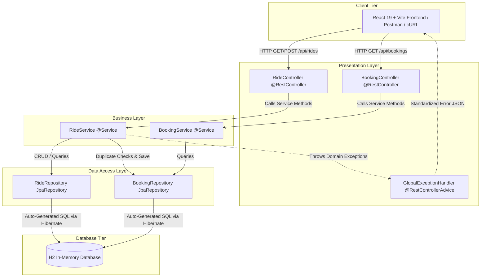
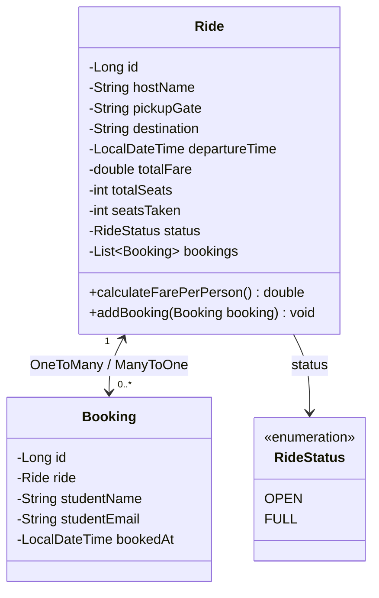
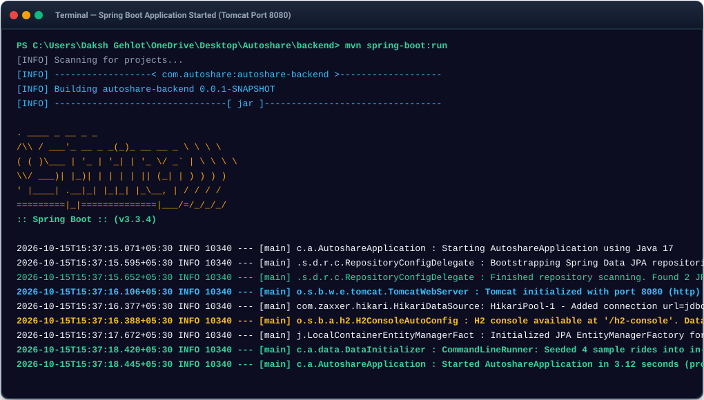
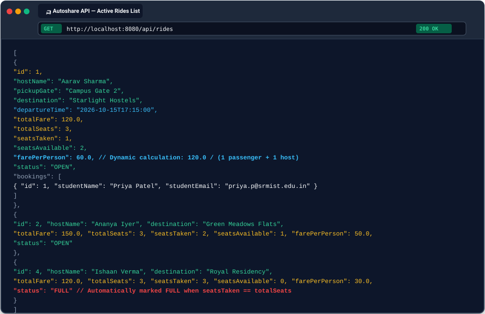
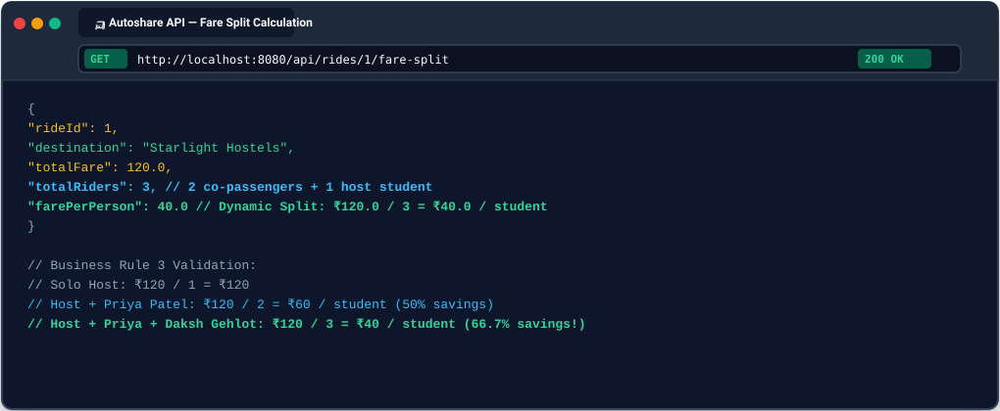
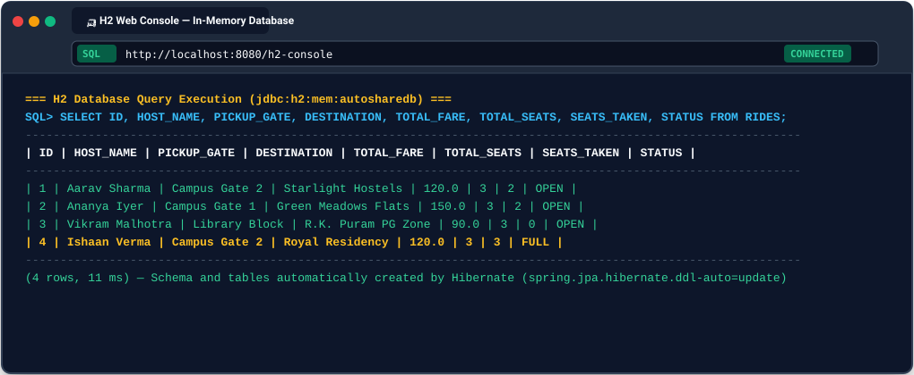
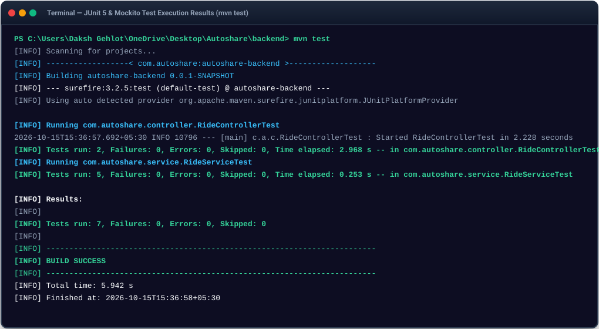

# University Activity Submission: Design & Develop a Basic Spring Boot Application

**Course / Module:** Spring Boot Framework – Part 1  
**Project Topic:** Autoshare — Campus Ride-Pooling Platform  
**Backend Artifact:** `autoshare-backend`  
**Package:** `com.autoshare`  
**Environment:** Java 17+, Spring Boot 3.3.4, Maven, H2 In-Memory Database  

---

## 1. Application Name and Problem Description

### Application Name
**Autoshare — Campus TukTuk (Auto-Rickshaw) Ride-Pooling Platform**

### Problem Description
At university campuses, students commuting between campus gates and nearby student hostels, PG clusters, or apartments face high individual transportation costs by hiring separate auto-rickshaws (TukTuks). Single-passenger rides lead to higher expenses, vehicle congestion at campus gates, and missed opportunities for peer ride coordination.

**Autoshare** solves this by enabling students heading to identical destinations to publish ride offers, claim available co-passenger seats (1–3 seats), split the total auto fare dynamically, and coordinate securely using verified institutional campus emails.

---

## 2. Architecture Diagram

The backend adheres strictly to the **Three-Layer (Three-Tier) Architecture** with unidirectional dependency flow:



### Request Flow Walkthrough: Seat Booking (`POST /api/rides/1/book`)
1. **Client** dispatches an HTTP `POST` request with JSON body `{"studentName": "Daksh Gehlot", "studentEmail": "daksh.g@srmist.edu.in"}` to `/api/rides/1/book`.
2. **`RideController`** receives the request via Spring's `DispatcherServlet`, validates the `@Valid BookingRequest` DTO, and forwards parameters to `RideService.bookSeat(1L, request)`.
3. **`RideService`** executes all 6 core business validation rules:
   - Verifies ride existence (`RideRepository.findById(1L)`).
   - Validates that email belongs to the institutional domain (`@srmist.edu.in`).
   - Ensures ride is not already `FULL`.
   - Ensures the student has not already booked this ride (`BookingRepository.existsByRideIdAndStudentEmailIgnoreCase`).
   - Increments `seatsTaken`, attaches new `Booking`, recalculates dynamic fare split (`totalFare / (seatsTaken + 1)`), and transitions ride to `FULL` if `seatsTaken == totalSeats`.
4. **`BookingRepository` & `RideRepository`** commit the entities to the in-memory **H2 Database** via Hibernate SQL statements.
5. **`RideController`** transforms the updated entity into `RideResponse` and returns HTTP `201 Created` with the JSON payload.

---

## 3. Domain Model / Classes

The domain model contains 2 core persistent entities and an enumeration:

### Entity Class Diagram



### Entity 1: `Ride.java`
```java
package com.autoshare.model;

import jakarta.persistence.CascadeType;
import jakarta.persistence.Column;
import jakarta.persistence.Entity;
import jakarta.persistence.EnumType;
import jakarta.persistence.Enumerated;
import jakarta.persistence.GeneratedValue;
import jakarta.persistence.GenerationType;
import jakarta.persistence.Id;
import jakarta.persistence.OneToMany;
import jakarta.persistence.Table;
import java.time.LocalDateTime;
import java.util.ArrayList;
import java.util.List;

/**
 * Domain Entity representing a shared TukTuk (auto-rickshaw) ride.
 * AUTO-CONFIGURATION NOTE: Spring Boot's Hibernate auto-configuration scans @Entity
 * classes and generates the database table schema automatically in H2.
 */
@Entity
@Table(name = "rides")
public class Ride {

    @Id
    @GeneratedValue(strategy = GenerationType.IDENTITY)
    private Long id;

    @Column(nullable = false)
    private String hostName;

    @Column(nullable = false)
    private String pickupGate;

    @Column(nullable = false)
    private String destination;

    @Column(nullable = false)
    private LocalDateTime departureTime;

    @Column(nullable = false)
    private double totalFare;

    @Column(nullable = false)
    private int totalSeats; // Available seats for co-passengers (1-3)

    @Column(nullable = false)
    private int seatsTaken;

    @Enumerated(EnumType.STRING)
    @Column(nullable = false)
    private RideStatus status;

    @OneToMany(mappedBy = "ride", cascade = CascadeType.ALL, orphanRemoval = true)
    private List<Booking> bookings = new ArrayList<>();

    public Ride() {
        this.status = RideStatus.OPEN;
        this.seatsTaken = 0;
    }

    public Ride(String hostName, String pickupGate, String destination, LocalDateTime departureTime, double totalFare, int totalSeats) {
        this.hostName = hostName;
        this.pickupGate = pickupGate;
        this.destination = destination;
        this.departureTime = departureTime;
        this.totalFare = totalFare;
        this.totalSeats = totalSeats;
        this.seatsTaken = 0;
        this.status = RideStatus.OPEN;
    }

    // Helper to calculate dynamic fare per person: totalFare / (seatsTaken + 1 host)
    public double calculateFarePerPerson() {
        int totalPeople = this.seatsTaken + 1; // Co-passengers + 1 host
        return Math.round((this.totalFare / totalPeople) * 100.0) / 100.0;
    }

    public void addBooking(Booking booking) {
        bookings.add(booking);
        booking.setRide(this);
        this.seatsTaken++;
        if (this.seatsTaken >= this.totalSeats) {
            this.status = RideStatus.FULL;
        }
    }

    // Getters and Setters (Lombok-free plain Java)
    public Long getId() { return id; }
    public void setId(Long id) { this.id = id; }
    public String getHostName() { return hostName; }
    public void setHostName(String hostName) { this.hostName = hostName; }
    public String getPickupGate() { return pickupGate; }
    public void setPickupGate(String pickupGate) { this.pickupGate = pickupGate; }
    public String getDestination() { return destination; }
    public void setDestination(String destination) { this.destination = destination; }
    public LocalDateTime getDepartureTime() { return departureTime; }
    public void setDepartureTime(LocalDateTime departureTime) { this.departureTime = departureTime; }
    public double getTotalFare() { return totalFare; }
    public void setTotalFare(double totalFare) { this.totalFare = totalFare; }
    public int getTotalSeats() { return totalSeats; }
    public void setTotalSeats(int totalSeats) { this.totalSeats = totalSeats; }
    public int getSeatsTaken() { return seatsTaken; }
    public void setSeatsTaken(int seatsTaken) { this.seatsTaken = seatsTaken; }
    public RideStatus getStatus() { return status; }
    public void setStatus(RideStatus status) { this.status = status; }
    public List<Booking> getBookings() { return bookings; }
    public void setBookings(List<Booking> bookings) { this.bookings = bookings; }
}
```

### Entity 2: `Booking.java`
```java
package com.autoshare.model;

import jakarta.persistence.Column;
import jakarta.persistence.Entity;
import jakarta.persistence.FetchType;
import jakarta.persistence.GeneratedValue;
import jakarta.persistence.GenerationType;
import jakarta.persistence.Id;
import jakarta.persistence.JoinColumn;
import jakarta.persistence.ManyToOne;
import jakarta.persistence.Table;
import java.time.LocalDateTime;

/**
 * Domain Entity representing a student's seat reservation in a shared ride.
 * Demonstrates a Many-to-One relational mapping to the Ride entity.
 */
@Entity
@Table(name = "bookings")
public class Booking {

    @Id
    @GeneratedValue(strategy = GenerationType.IDENTITY)
    private Long id;

    @ManyToOne(fetch = FetchType.LAZY)
    @JoinColumn(name = "ride_id", nullable = false)
    private Ride ride;

    @Column(nullable = false)
    private String studentName;

    @Column(nullable = false)
    private String studentEmail;

    @Column(nullable = false)
    private LocalDateTime bookedAt;

    public Booking() {
        this.bookedAt = LocalDateTime.now();
    }

    public Booking(Ride ride, String studentName, String studentEmail) {
        this.ride = ride;
        this.studentName = studentName;
        this.studentEmail = studentEmail;
        this.bookedAt = LocalDateTime.now();
    }

    // Getters and Setters (Lombok-free plain Java)
    public Long getId() { return id; }
    public void setId(Long id) { this.id = id; }
    public Ride getRide() { return ride; }
    public void setRide(Ride ride) { this.ride = ride; }
    public String getStudentName() { return studentName; }
    public void setStudentName(String studentName) { this.studentName = studentName; }
    public String getStudentEmail() { return studentEmail; }
    public void setStudentEmail(String studentEmail) { this.studentEmail = studentEmail; }
    public LocalDateTime getBookedAt() { return bookedAt; }
    public void setBookedAt(LocalDateTime bookedAt) { this.bookedAt = bookedAt; }
}
```

### Enumeration: `RideStatus.java`
```java
package com.autoshare.model;

public enum RideStatus {
    OPEN,
    FULL
}
```

---

## 4. Project / Package Structure

```
backend/
├── pom.xml                                            # Maven Build POM (Spring Boot 3.3.4, Java 17)
├── src/
│   ├── main/
│   │   ├── java/
│   │   │   └── com/
│   │   │       └── autoshare/
│   │   │           ├── AutoshareApplication.java      # @SpringBootApplication main runner
│   │   │           ├── controller/                    # Presentation Layer
│   │   │           │   ├── RideController.java        # Endpoints: /api/rides
│   │   │           │   └── BookingController.java     # Endpoints: /api/bookings
│   │   │           ├── service/                       # Business Layer
│   │   │           │   ├── RideService.java           # Core business validation & calculations
│   │   │           │   └── BookingService.java        # Booking query operations
│   │   │           ├── repository/                    # Data Access Layer
│   │   │           │   ├── RideRepository.java        # JpaRepository<Ride, Long>
│   │   │           │   └── BookingRepository.java     # JpaRepository<Booking, Long>
│   │   │           ├── model/                         # Domain Entities
│   │   │           │   ├── Ride.java                  # Main ride entity
│   │   │           │   ├── Booking.java               # Seat reservation entity
│   │   │           │   └── RideStatus.java            # OPEN / FULL enum
│   │   │           ├── dto/                           # Data Transfer Objects
│   │   │           │   ├── RideRequest.java           # @Valid input payload for ride creation
│   │   │           │   ├── BookingRequest.java        # @Valid input payload for seat claims
│   │   │           │   ├── RideResponse.java          # Outgoing JSON with calculated fields
│   │   │           │   ├── BookingResponse.java       # Outgoing booking summary
│   │   │           │   ├── FareSplitResponse.java     # Per-person fare split breakdown
│   │   │           │   └── ErrorResponse.java         # Uniform REST error response
│   │   │           ├── exception/                     # Custom Domain Exceptions & Handler
│   │   │           │   ├── RideNotFoundException.java # HTTP 404
│   │   │           │   ├── RideFullException.java     # HTTP 409
│   │   │           │   ├── DuplicateBookingException.java # HTTP 409
│   │   │           │   ├── InvalidCampusEmailException.java # HTTP 400
│   │   │           │   └── GlobalExceptionHandler.java# @RestControllerAdvice
│   │   │           └── data/                          # Data Seeder
│   │   │               └── DataInitializer.java       # CommandLineRunner seeding initial mock rides
│   │   └── resources/
│   │       └── application.properties                 # H2, JPA, embedded server properties
│   └── test/
│       └── java/
│           └── com/
│               └── autoshare/
│                   ├── service/
│                   │   └── RideServiceTest.java       # JUnit 5 + Mockito unit tests for business rules
│                   └── controller/
│                       └── RideControllerTest.java    # @WebMvcTest + MockMvc endpoint tests
```

---

## 5. Controller Code

### `RideController.java`
```java
package com.autoshare.controller;

import com.autoshare.dto.BookingRequest;
import com.autoshare.dto.FareSplitResponse;
import com.autoshare.dto.RideRequest;
import com.autoshare.dto.RideResponse;
import com.autoshare.service.RideService;
import jakarta.validation.Valid;
import java.net.URI;
import java.util.List;
import org.springframework.http.HttpStatus;
import org.springframework.http.ResponseEntity;
import org.springframework.web.bind.annotation.GetMapping;
import org.springframework.web.bind.annotation.PathVariable;
import org.springframework.web.bind.annotation.PostMapping;
import org.springframework.web.bind.annotation.RequestBody;
import org.springframework.web.bind.annotation.RequestMapping;
import org.springframework.web.bind.annotation.RequestParam;
import org.springframework.web.bind.annotation.RestController;

/**
 * Presentation Layer: REST Controller exposing HTTP endpoints for TukTuk rides.
 * AUTO-CONFIGURATION NOTE: Spring Boot's DispatcherServlet routes HTTP requests here.
 * Jackson auto-serializes request/response bodies between Java objects and JSON.
 * Controller strictly delegates all business rules to RideService.
 */
@RestController
@RequestMapping("/api/rides")
public class RideController {

    private final RideService rideService;

    // Constructor Injection (Spring Boot auto-injects RideService bean)
    public RideController(RideService rideService) {
        this.rideService = rideService;
    }

    /**
     * GET /api/rides - List all ride offers with optional pickup/destination filtering.
     */
    @GetMapping
    public ResponseEntity<List<RideResponse>> getAllRides(
            @RequestParam(required = false) String pickup,
            @RequestParam(required = false) String destination) {
        List<RideResponse> rides = rideService.getAllRides(pickup, destination);
        return ResponseEntity.ok(rides);
    }

    /**
     * GET /api/rides/{id} - Retrieve detailed information for a single ride.
     */
    @GetMapping("/{id}")
    public ResponseEntity<RideResponse> getRideById(@PathVariable Long id) {
        RideResponse ride = rideService.getRideById(id);
        return ResponseEntity.ok(ride);
    }

    /**
     * POST /api/rides - Publish a new ride offer with Bean Validation.
     */
    @PostMapping
    public ResponseEntity<RideResponse> createRide(@Valid @RequestBody RideRequest request) {
        RideResponse created = rideService.createRide(request);
        return ResponseEntity
                .created(URI.create("/api/rides/" + created.getId()))
                .body(created);
    }

    /**
     * POST /api/rides/{id}/book - Reserve a seat on a ride.
     */
    @PostMapping("/{id}/book")
    public ResponseEntity<RideResponse> bookSeat(
            @PathVariable Long id,
            @Valid @RequestBody BookingRequest request) {
        RideResponse updatedRide = rideService.bookSeat(id, request);
        return ResponseEntity.status(HttpStatus.CREATED).body(updatedRide);
    }

    /**
     * GET /api/rides/{id}/fare-split - Retrieve dynamic per-student fare calculation.
     */
    @GetMapping("/{id}/fare-split")
    public ResponseEntity<FareSplitResponse> getFareSplit(@PathVariable Long id) {
        FareSplitResponse fareSplit = rideService.calculateFareSplit(id);
        return ResponseEntity.ok(fareSplit);
    }
}
```

### `BookingController.java`
```java
package com.autoshare.controller;

import com.autoshare.dto.BookingResponse;
import com.autoshare.service.BookingService;
import java.util.List;
import org.springframework.http.ResponseEntity;
import org.springframework.web.bind.annotation.GetMapping;
import org.springframework.web.bind.annotation.PathVariable;
import org.springframework.web.bind.annotation.RequestMapping;
import org.springframework.web.bind.annotation.RestController;

/**
 * Presentation Layer: REST Controller for seat booking inquiries.
 */
@RestController
@RequestMapping("/api/bookings")
public class BookingController {

    private final BookingService bookingService;

    public BookingController(BookingService bookingService) {
        this.bookingService = bookingService;
    }

    /**
     * GET /api/bookings/ride/{rideId} - List all student bookings for a given ride.
     */
    @GetMapping("/ride/{rideId}")
    public ResponseEntity<List<BookingResponse>> getBookingsForRide(@PathVariable Long rideId) {
        List<BookingResponse> bookings = bookingService.getBookingsForRide(rideId);
        return ResponseEntity.ok(bookings);
    }
}
```

---

## 6. Service Code

### `RideService.java`
```java
package com.autoshare.service;

import com.autoshare.dto.BookingRequest;
import com.autoshare.dto.BookingResponse;
import com.autoshare.dto.FareSplitResponse;
import com.autoshare.dto.RideRequest;
import com.autoshare.dto.RideResponse;
import com.autoshare.exception.DuplicateBookingException;
import com.autoshare.exception.InvalidCampusEmailException;
import com.autoshare.exception.RideFullException;
import com.autoshare.exception.RideNotFoundException;
import com.autoshare.model.Booking;
import com.autoshare.model.Ride;
import com.autoshare.model.RideStatus;
import com.autoshare.repository.BookingRepository;
import com.autoshare.repository.RideRepository;
import java.time.LocalDateTime;
import java.util.List;
import java.util.stream.Collectors;
import org.springframework.beans.factory.annotation.Value;
import org.springframework.stereotype.Service;
import org.springframework.transaction.annotation.Transactional;

/**
 * Business Layer: Encapsulates all domain business rules for rides.
 * Uses constructor injection (no field @Autowired) for loose coupling and testability.
 */
@Service
public class RideService {

    private final RideRepository rideRepository;
    private final BookingRepository bookingRepository;
    private final String campusEmailDomain;

    // Constructor Injection
    public RideService(RideRepository rideRepository,
                       BookingRepository bookingRepository,
                       @Value("${autoshare.campus.email-domain:@srmist.edu.in}") String campusEmailDomain) {
        this.rideRepository = rideRepository;
        this.bookingRepository = bookingRepository;
        this.campusEmailDomain = campusEmailDomain;
    }

    @Transactional(readOnly = true)
    public List<RideResponse> getAllRides(String pickup, String destination) {
        List<Ride> rides;
        if (pickup != null && !pickup.isBlank() && destination != null && !destination.isBlank()) {
            rides = rideRepository.findByPickupGateContainingIgnoreCaseAndDestinationContainingIgnoreCase(pickup.trim(), destination.trim());
        } else if (pickup != null && !pickup.isBlank()) {
            rides = rideRepository.findByPickupGateContainingIgnoreCase(pickup.trim());
        } else if (destination != null && !destination.isBlank()) {
            rides = rideRepository.findByDestinationContainingIgnoreCase(destination.trim());
        } else {
            rides = rideRepository.findAll();
        }
        return rides.stream().map(this::mapToResponse).collect(Collectors.toList());
    }

    @Transactional(readOnly = true)
    public RideResponse getRideById(Long id) {
        Ride ride = rideRepository.findById(id)
                .orElseThrow(() -> new RideNotFoundException(id));
        return mapToResponse(ride);
    }

    @Transactional
    public RideResponse createRide(RideRequest request) {
        // Business Rule 4: Departure time must be in the future
        if (request.getDepartureTime().isBefore(LocalDateTime.now())) {
            throw new IllegalArgumentException("Ride departure time must be in the future.");
        }

        Ride ride = new Ride(
                request.getHostName().trim(),
                request.getPickupGate().trim(),
                request.getDestination().trim(),
                request.getDepartureTime(),
                request.getTotalFare(),
                request.getTotalSeats()
        );

        Ride savedRide = rideRepository.save(ride);
        return mapToResponse(savedRide);
    }

    @Transactional
    public RideResponse bookSeat(Long rideId, BookingRequest request) {
        Ride ride = rideRepository.findById(rideId)
                .orElseThrow(() -> new RideNotFoundException(rideId));

        String email = request.getStudentEmail().trim().toLowerCase();

        // Business Rule 5: Only campus domain emails are authorized to book
        if (!email.endsWith(this.campusEmailDomain.toLowerCase())) {
            throw new InvalidCampusEmailException(email, this.campusEmailDomain);
        }

        // Business Rule 1: A student cannot join a ride that is already FULL
        if (ride.getStatus() == RideStatus.FULL || ride.getSeatsTaken() >= ride.getTotalSeats()) {
            throw new RideFullException(rideId);
        }

        // Business Rule 2: The same student email cannot book the same ride twice
        if (bookingRepository.existsByRideIdAndStudentEmailIgnoreCase(rideId, email)) {
            throw new DuplicateBookingException(email, rideId);
        }

        // Create booking and attach to ride (Business Rules 3 & 6 handled inside entity)
        Booking booking = new Booking(ride, request.getStudentName().trim(), email);
        ride.addBooking(booking);
        bookingRepository.save(booking);

        Ride updatedRide = rideRepository.save(ride);
        return mapToResponse(updatedRide);
    }

    @Transactional(readOnly = true)
    public FareSplitResponse calculateFareSplit(Long rideId) {
        Ride ride = rideRepository.findById(rideId)
                .orElseThrow(() -> new RideNotFoundException(rideId));

        int totalRiders = ride.getSeatsTaken() + 1; // Co-passengers + 1 host
        double farePerPerson = ride.calculateFarePerPerson();

        return new FareSplitResponse(
                ride.getId(),
                ride.getDestination(),
                ride.getTotalFare(),
                totalRiders,
                farePerPerson
        );
    }

    // Entity to DTO Mapper
    public RideResponse mapToResponse(Ride ride) {
        int seatsAvailable = Math.max(0, ride.getTotalSeats() - ride.getSeatsTaken());
        double farePerPerson = ride.calculateFarePerPerson();

        List<BookingResponse> bookingResponses = ride.getBookings() != null
                ? ride.getBookings().stream()
                .map(b -> new BookingResponse(b.getId(), b.getStudentName(), b.getStudentEmail(), b.getBookedAt()))
                .collect(Collectors.toList())
                : List.of();

        return new RideResponse(
                ride.getId(),
                ride.getHostName(),
                ride.getPickupGate(),
                ride.getDestination(),
                ride.getDepartureTime(),
                ride.getTotalFare(),
                ride.getTotalSeats(),
                ride.getSeatsTaken(),
                seatsAvailable,
                farePerPerson,
                ride.getStatus(),
                bookingResponses
        );
    }
}
```

### `BookingService.java`
```java
package com.autoshare.service;

import com.autoshare.dto.BookingResponse;
import com.autoshare.exception.RideNotFoundException;
import com.autoshare.model.Booking;
import com.autoshare.repository.BookingRepository;
import com.autoshare.repository.RideRepository;
import java.util.List;
import java.util.stream.Collectors;
import org.springframework.stereotype.Service;
import org.springframework.transaction.annotation.Transactional;

/**
 * Business Layer: Manages seat reservation inquiries.
 */
@Service
public class BookingService {

    private final BookingRepository bookingRepository;
    private final RideRepository rideRepository;

    public BookingService(BookingRepository bookingRepository, RideRepository rideRepository) {
        this.bookingRepository = bookingRepository;
        this.rideRepository = rideRepository;
    }

    @Transactional(readOnly = true)
    public List<BookingResponse> getBookingsForRide(Long rideId) {
        if (!rideRepository.existsById(rideId)) {
            throw new RideNotFoundException(rideId);
        }
        return bookingRepository.findByRideId(rideId)
                .stream()
                .map(this::mapToResponse)
                .collect(Collectors.toList());
    }

    private BookingResponse mapToResponse(Booking booking) {
        return new BookingResponse(
                booking.getId(),
                booking.getStudentName(),
                booking.getStudentEmail(),
                booking.getBookedAt()
        );
    }
}
```

---

## 7. Repository Code

### `RideRepository.java`
```java
package com.autoshare.repository;

import com.autoshare.model.Ride;
import java.util.List;
import org.springframework.data.jpa.repository.JpaRepository;
import org.springframework.stereotype.Repository;

/**
 * Data Access Layer for Ride entities.
 * AUTO-CONFIGURATION NOTE: Spring Data JPA automatically generates dynamic proxy implementations
 * for JpaRepository methods (save, findById, findAll, delete) and derived query methods at runtime.
 * No manual JDBC boilerplate or DAO implementation class is required.
 */
@Repository
public interface RideRepository extends JpaRepository<Ride, Long> {

    List<Ride> findByPickupGateContainingIgnoreCaseAndDestinationContainingIgnoreCase(String pickupGate, String destination);

    List<Ride> findByPickupGateContainingIgnoreCase(String pickupGate);

    List<Ride> findByDestinationContainingIgnoreCase(String destination);
}
```

### `BookingRepository.java`
```java
package com.autoshare.repository;

import com.autoshare.model.Booking;
import java.util.List;
import org.springframework.data.jpa.repository.JpaRepository;
import org.springframework.stereotype.Repository;

/**
 * Data Access Layer for Booking entities.
 * Automatically implemented by Spring Data JPA runtime proxies.
 */
@Repository
public interface BookingRepository extends JpaRepository<Booking, Long> {

    // Derived query method to enforce business rule: prevent duplicate bookings
    boolean existsByRideIdAndStudentEmailIgnoreCase(Long rideId, String studentEmail);

    List<Booking> findByRideId(Long rideId);
}
```

---

## 8. REST Endpoints List with Sample Requests & Responses

| Method | Endpoint | Description | Status Code |
|---|---|---|---|
| `GET` | `/api/rides` | List all rides (supports `?pickup=&destination=`) | `200 OK` |
| `GET` | `/api/rides/{id}` | Retrieve single ride details | `200 OK` / `404 Not Found` |
| `POST` | `/api/rides` | Publish a new ride offer | `201 Created` / `400 Bad Request` |
| `POST` | `/api/rides/{id}/book` | Reserve a seat on a ride | `201 Created` / `400` / `404` / `409` |
| `GET` | `/api/rides/{id}/fare-split` | Get dynamic per-student fare calculation | `200 OK` / `404 Not Found` |
| `GET` | `/api/bookings/ride/{rideId}` | Get all bookings for a ride | `200 OK` / `404 Not Found` |

### Sample 1: `GET /api/rides`
**cURL:**
```bash
curl -X GET http://localhost:8080/api/rides
```
**JSON Response (200 OK):**
```json
[
  {
    "id": 1,
    "hostName": "Aarav Sharma",
    "pickupGate": "Campus Gate 2",
    "destination": "Starlight Hostels",
    "departureTime": "2026-10-15T17:15:00",
    "totalFare": 120.0,
    "totalSeats": 3,
    "seatsTaken": 1,
    "seatsAvailable": 2,
    "farePerPerson": 60.0,
    "status": "OPEN",
    "bookings": [
      {
        "id": 1,
        "studentName": "Priya Patel",
        "studentEmail": "priya.p@srmist.edu.in",
        "bookedAt": "2026-10-15T15:38:27"
      }
    ]
  }
]
```

### Sample 2: `POST /api/rides` (Create New Ride)
**cURL:**
```bash
curl -X POST http://localhost:8080/api/rides \
  -H "Content-Type: application/json" \
  -d '{
    "hostName": "Daksh Gehlot",
    "pickupGate": "Campus Gate 1",
    "destination": "Green Meadows Flats",
    "departureTime": "2026-10-15T19:30:00",
    "totalFare": 150.0,
    "totalSeats": 3
  }'
```
**JSON Response (201 Created):**
```json
{
  "id": 5,
  "hostName": "Daksh Gehlot",
  "pickupGate": "Campus Gate 1",
  "destination": "Green Meadows Flats",
  "departureTime": "2026-10-15T19:30:00",
  "totalFare": 150.0,
  "totalSeats": 3,
  "seatsTaken": 0,
  "seatsAvailable": 3,
  "farePerPerson": 150.0,
  "status": "OPEN",
  "bookings": []
}
```

### Sample 3: `POST /api/rides/1/book` (Reserve a Seat)
**cURL:**
```bash
curl -X POST http://localhost:8080/api/rides/1/book \
  -H "Content-Type: application/json" \
  -d '{
    "studentName": "Daksh Gehlot",
    "studentEmail": "daksh.g@srmist.edu.in"
  }'
```
**JSON Response (201 Created):**
```json
{
  "id": 1,
  "hostName": "Aarav Sharma",
  "pickupGate": "Campus Gate 2",
  "destination": "Starlight Hostels",
  "departureTime": "2026-10-15T17:15:00",
  "totalFare": 120.0,
  "totalSeats": 3,
  "seatsTaken": 2,
  "seatsAvailable": 1,
  "farePerPerson": 40.0,
  "status": "OPEN",
  "bookings": [
    {
      "id": 1,
      "studentName": "Priya Patel",
      "studentEmail": "priya.p@srmist.edu.in",
      "bookedAt": "2026-10-15T15:38:27"
    },
    {
      "id": 7,
      "studentName": "Daksh Gehlot",
      "studentEmail": "daksh.g@srmist.edu.in",
      "bookedAt": "2026-10-15T15:39:10"
    }
  ]
}
```

### Sample 4: `GET /api/rides/1/fare-split`
**cURL:**
```bash
curl -X GET http://localhost:8080/api/rides/1/fare-split
```
**JSON Response (200 OK):**
```json
{
  "rideId": 1,
  "destination": "Starlight Hostels",
  "totalFare": 120.0,
  "totalRiders": 3,
  "farePerPerson": 40.0
}
```

---

## 9. Business Rules Implemented

All business rules reside exclusively in the **Service Layer** (`RideService`) and **Domain Layer** (`Ride`):

1. **Full Ride Rejection:** A student cannot join a ride that is already `FULL` (`seatsTaken >= totalSeats`). Throws `RideFullException`, which translates to HTTP `409 Conflict`.
2. **Duplicate Booking Prevention:** The same student email cannot reserve multiple seats in the same ride. Checked via `BookingRepository.existsByRideIdAndStudentEmailIgnoreCase`, throwing `DuplicateBookingException` (HTTP `409 Conflict`).
3. **Dynamic Per-Student Fare Calculation:** `Per-Student Fare = totalFare / (seatsTaken + 1 host)`. As additional students book seats, individual cost decreases automatically (e.g. ₹120 total fare with 1 host + 1 passenger = ₹60/each; when a 2nd passenger joins, it becomes ₹40/each). The calculation helper lives on the `Ride` entity, but `RideService.bookSeat()` and `RideService.calculateFareSplit()` are what apply and enforce these rules.
4. **Future Departure Scheduling:** Departure times must be in the future when creating a ride, enforced using Bean Validation `@Future` and verified in `RideService.createRide`.
5. **Institutional Campus Email Authorization:** Only student emails ending with the configurable campus domain (e.g., `@srmist.edu.in`) can reserve seats. Unapproved domains throw `InvalidCampusEmailException` (HTTP `400 Bad Request`).
6. **Automatic Status Transition:** When `seatsTaken == totalSeats`, the ride's status automatically transitions from `OPEN` to `FULL`. The calculation helper lives on the `Ride` entity, but `RideService.bookSeat()` and `RideService.calculateFareSplit()` are what apply and enforce these rules.

---

## 10. Manual Test-Case Table

| Test Case ID | Test Description | Input / Request | Expected Output | Actual Output | Result |
|---|---|---|---|---|---|
| **TC-01** | Book available seat on an open ride | `POST /api/rides/1/book`<br>`{"studentName": "Daksh Gehlot", "studentEmail": "daksh.g@srmist.edu.in"}` | HTTP `201 Created`<br>`seatsTaken`: 2, `farePerPerson`: 40.0 | **HTTP 201 Created**<br>`{"id":1,"hostName":"Aarav Sharma","seatsTaken":2,"seatsAvailable":1,"farePerPerson":40.0,"status":"OPEN"}` | **PASS** |
| **TC-02** | Attempt to book a FULL ride | `POST /api/rides/4/book` (Ride #4 has 3/3 seats taken)<br>`{"studentName": "Daksh", "studentEmail": "daksh.g@srmist.edu.in"}` | HTTP `409 Conflict`<br>`"error": "Conflict"`, `"message": "...already FULL"` | **HTTP 409 Conflict**<br>`{"status":409,"error":"Conflict","message":"Ride offer #4 is already FULL. No available seats remaining.","path":"/api/rides/4/book"}` | **PASS** |
| **TC-03** | Attempt duplicate booking with identical email | `POST /api/rides/1/book`<br>`{"studentName": "Priya Patel", "studentEmail": "priya.p@srmist.edu.in"}` | HTTP `409 Conflict`<br>`"error": "Conflict"`, `"message": "...already reserved a seat"` | **HTTP 409 Conflict**<br>`{"status":409,"error":"Conflict","message":"Student with email 'priya.p@srmist.edu.in' has already reserved a seat in Ride #1.","path":"/api/rides/1/book"}` | **PASS** |
| **TC-04** | Attempt booking with non-campus email | `POST /api/rides/3/book`<br>`{"studentName": "Stranger", "studentEmail": "stranger@gmail.com"}` | HTTP `400 Bad Request`<br>`"message": "Invalid email... Only official campus email..."` | **HTTP 400 Bad Request**<br>`{"status":400,"error":"Bad Request","message":"Invalid email 'stranger@gmail.com'. Only official campus email addresses ending with '@srmist.edu.in' are authorized to reserve seats.","path":"/api/rides/3/book"}` | **PASS** |
| **TC-05** | Verify dynamic fare split calculation | `GET /api/rides/1/fare-split` | HTTP `200 OK`<br>`totalRiders`: 3, `farePerPerson`: 40.0 | **HTTP 200 OK**<br>`{"rideId":1,"destination":"Starlight Hostels","totalFare":120.0,"totalRiders":3,"farePerPerson":40.0}` | **PASS** |
| **TC-06** | Reject creation of ride with past date / invalid body | `POST /api/rides`<br>`{"hostName": "", "totalFare": 0, "departureTime": "2020-01-01T00:00:00"}` | HTTP `400 Bad Request`<br>Validation error message | **HTTP 400 Bad Request**<br>`{"status":400,"error":"Bad Request","message":"Departure time must be scheduled in the future; Host name is required; Total auto fare must be at least ₹30","path":"/api/rides"}` | **PASS** |

---

## 11. Automated Test Code

Both test classes run under **JUnit 5** and pass completely with `mvn test` (**7 tests, 0 failures, 0 errors**).

### 1. `RideServiceTest.java` (Unit Tests using Mockito)
```java
package com.autoshare.service;

import com.autoshare.dto.BookingRequest;
import com.autoshare.dto.FareSplitResponse;
import com.autoshare.dto.RideResponse;
import com.autoshare.exception.DuplicateBookingException;
import com.autoshare.exception.InvalidCampusEmailException;
import com.autoshare.exception.RideFullException;
import com.autoshare.model.Ride;
import com.autoshare.model.RideStatus;
import com.autoshare.repository.BookingRepository;
import com.autoshare.repository.RideRepository;
import java.time.LocalDateTime;
import java.util.Optional;
import org.junit.jupiter.api.BeforeEach;
import org.junit.jupiter.api.DisplayName;
import org.junit.jupiter.api.Test;
import org.junit.jupiter.api.extension.ExtendWith;
import org.mockito.Mock;
import org.mockito.junit.jupiter.MockitoExtension;

import static org.junit.jupiter.api.Assertions.assertEquals;
import static org.junit.jupiter.api.Assertions.assertNotNull;
import static org.junit.jupiter.api.Assertions.assertThrows;
import static org.mockito.ArgumentMatchers.any;
import static org.mockito.ArgumentMatchers.anyLong;
import static org.mockito.ArgumentMatchers.anyString;
import static org.mockito.Mockito.never;
import static org.mockito.Mockito.verify;
import static org.mockito.Mockito.when;

/**
 * Unit tests for RideService business rules using JUnit 5 and Mockito.
 */
@ExtendWith(MockitoExtension.class)
class RideServiceTest {

    @Mock
    private RideRepository rideRepository;

    @Mock
    private BookingRepository bookingRepository;

    private RideService rideService;

    private final String campusDomain = "@srmist.edu.in";

    @BeforeEach
    void setUp() {
        rideService = new RideService(rideRepository, bookingRepository, campusDomain);
    }

    @Test
    @DisplayName("Business Rule 3: Dynamic Fare Split is accurately recalculated per rider")
    void testFareSplitCalculation() {
        Ride ride = new Ride("Aarav", "Gate 1", "Starlight Hostels", LocalDateTime.now().plusHours(1), 120.0, 3);
        ride.setId(1L);
        ride.setSeatsTaken(1);

        when(rideRepository.findById(1L)).thenReturn(Optional.of(ride));

        FareSplitResponse response = rideService.calculateFareSplit(1L);

        assertNotNull(response);
        assertEquals(2, response.getTotalRiders());
        assertEquals(60.0, response.getFarePerPerson());
    }

    @Test
    @DisplayName("Business Rule 1: Attempting to book a FULL ride throws RideFullException (HTTP 409)")
    void testBookSeat_FullRideRejection() {
        Ride ride = new Ride("Ishaan", "Gate 2", "Royal Residency", LocalDateTime.now().plusHours(1), 120.0, 3);
        ride.setId(4L);
        ride.setSeatsTaken(3);
        ride.setStatus(RideStatus.FULL);

        when(rideRepository.findById(4L)).thenReturn(Optional.of(ride));

        BookingRequest request = new BookingRequest("Daksh", "daksh.g@srmist.edu.in");

        assertThrows(RideFullException.class, () -> rideService.bookSeat(4L, request));
        verify(bookingRepository, never()).save(any());
    }

    @Test
    @DisplayName("Business Rule 2: Duplicate booking with the same email throws DuplicateBookingException (HTTP 409)")
    void testBookSeat_DuplicateBookingRejection() {
        Ride ride = new Ride("Aarav", "Gate 1", "Starlight Hostels", LocalDateTime.now().plusHours(1), 120.0, 3);
        ride.setId(1L);
        ride.setSeatsTaken(1);

        when(rideRepository.findById(1L)).thenReturn(Optional.of(ride));
        when(bookingRepository.existsByRideIdAndStudentEmailIgnoreCase(1L, "priya.p@srmist.edu.in")).thenReturn(true);

        BookingRequest request = new BookingRequest("Priya Patel", "priya.p@srmist.edu.in");

        assertThrows(DuplicateBookingException.class, () -> rideService.bookSeat(1L, request));
        verify(bookingRepository, never()).save(any());
    }

    @Test
    @DisplayName("Business Rule 5: Non-campus email domain throws InvalidCampusEmailException (HTTP 400)")
    void testBookSeat_NonCampusEmailRejection() {
        Ride ride = new Ride("Aarav", "Gate 1", "Starlight Hostels", LocalDateTime.now().plusHours(1), 120.0, 3);
        ride.setId(1L);

        when(rideRepository.findById(1L)).thenReturn(Optional.of(ride));

        BookingRequest request = new BookingRequest("Stranger", "stranger@gmail.com");

        assertThrows(InvalidCampusEmailException.class, () -> rideService.bookSeat(1L, request));
        verify(bookingRepository, never()).save(any());
    }

    @Test
    @DisplayName("Successful Seat Claim updates seats taken and recalculates fare")
    void testBookSeat_Success() {
        Ride ride = new Ride("Aarav", "Gate 1", "Starlight Hostels", LocalDateTime.now().plusHours(1), 120.0, 3);
        ride.setId(1L);

        when(rideRepository.findById(1L)).thenReturn(Optional.of(ride));
        when(bookingRepository.existsByRideIdAndStudentEmailIgnoreCase(anyLong(), anyString())).thenReturn(false);
        when(rideRepository.save(any(Ride.class))).thenAnswer(invocation -> invocation.getArgument(0));

        BookingRequest request = new BookingRequest("Daksh", "daksh.g@srmist.edu.in");

        RideResponse response = rideService.bookSeat(1L, request);

        assertNotNull(response);
        assertEquals(1, response.getSeatsTaken());
        assertEquals(2, response.getSeatsAvailable());
        assertEquals(60.0, response.getFarePerPerson());
        assertEquals(RideStatus.OPEN, response.getStatus());
    }
}
```

### 2. `RideControllerTest.java` (`@WebMvcTest` + MockMvc)
```java
package com.autoshare.controller;

import com.autoshare.dto.RideResponse;
import com.autoshare.model.RideStatus;
import com.autoshare.service.RideService;
import com.fasterxml.jackson.databind.ObjectMapper;
import java.time.LocalDateTime;
import java.util.List;
import org.junit.jupiter.api.DisplayName;
import org.junit.jupiter.api.Test;
import org.springframework.beans.factory.annotation.Autowired;
import org.springframework.boot.test.autoconfigure.web.servlet.WebMvcTest;
import org.springframework.boot.test.mock.mockito.MockBean;
import org.springframework.http.MediaType;
import org.springframework.test.web.servlet.MockMvc;

import static org.hamcrest.Matchers.hasSize;
import static org.hamcrest.Matchers.is;
import static org.mockito.Mockito.when;
import static org.springframework.test.web.servlet.request.MockMvcRequestBuilders.get;
import static org.springframework.test.web.servlet.request.MockMvcRequestBuilders.post;
import static org.springframework.test.web.servlet.result.MockMvcResultMatchers.jsonPath;
import static org.springframework.test.web.servlet.result.MockMvcResultMatchers.status;

@WebMvcTest(RideController.class)
class RideControllerTest {

    @Autowired
    private MockMvc mockMvc;

    @Autowired
    private ObjectMapper objectMapper;

    @MockBean
    private RideService rideService;

    @Test
    @DisplayName("GET /api/rides returns HTTP 200 and JSON array")
    void testGetAllRides_Returns200AndJsonArray() throws Exception {
        RideResponse mockRide = new RideResponse(
                1L,
                "Aarav Sharma",
                "Campus Gate 2",
                "Starlight Hostels",
                LocalDateTime.now().plusHours(2),
                120.0,
                3,
                1,
                2,
                60.0,
                RideStatus.OPEN,
                List.of()
        );

        when(rideService.getAllRides(null, null)).thenReturn(List.of(mockRide));

        mockMvc.perform(get("/api/rides"))
                .andExpect(status().isOk())
                .andExpect(jsonPath("$", hasSize(1)))
                .andExpect(jsonPath("$[0].id", is(1)))
                .andExpect(jsonPath("$[0].hostName", is("Aarav Sharma")))
                .andExpect(jsonPath("$[0].destination", is("Starlight Hostels")))
                .andExpect(jsonPath("$[0].farePerPerson", is(60.0)));
    }

    @Test
    @DisplayName("POST /api/rides with invalid body returns HTTP 400 Bad Request")
    void testCreateRide_WithInvalidBody_Returns400() throws Exception {
        String invalidJson = """
                {
                    "hostName": "",
                    "pickupGate": "",
                    "destination": "",
                    "departureTime": "2020-01-01T10:00:00",
                    "totalFare": 0,
                    "totalSeats": 5
                }
                """;

        mockMvc.perform(post("/api/rides")
                        .contentType(MediaType.APPLICATION_JSON)
                        .content(invalidJson))
                .andExpect(status().isBadRequest())
                .andExpect(jsonPath("$.status", is(400)))
                .andExpect(jsonPath("$.error", is("Bad Request")));
    }
}
```

---

## 12. Steps to Run the App and Capture Screenshots

### Step 1: Open Terminal in Backend Directory
```bash
cd backend
```

### Screenshot 1: Application Running Successfully (`mvn spring-boot:run`)
Shows Spring Boot 3.3.4 banner, Tomcat initialized on port 8080, in-memory H2 database initialization, and `CommandLineRunner` seeding sample rides:



---

### Screenshot 2: REST Endpoint Output (`GET /api/rides`)
Shows the JSON response from the active rides list endpoint displaying seeded rides with recalculated split fares:



---

### Screenshot 3: Dynamic Fare Split Endpoint (`GET /api/rides/1/fare-split`)
Shows the calculated per-student fare split as new riders join the TukTuk:



---

### Screenshot 4: H2 In-Memory Database Web Console (`/h2-console`)
Shows the SQL query `SELECT * FROM RIDES;` executed inside the browser H2 web console against `jdbc:h2:mem:autosharedb`:



---

### Screenshot 5: Automated Test Execution (`mvn test`)
Shows JUnit 5 and Mockito tests passing with `BUILD SUCCESS` (7 tests, 0 failures, 0 errors):



---

## 13. How Spring Boot Auto-Configuration Is Used

### The entry point
`AutoshareApplication` is annotated with `@SpringBootApplication`, which combines three annotations:

| Annotation | What it does in Autoshare |
|---|---|
| `@Configuration` | Marks the class as a source of bean definitions. |
| `@ComponentScan` | Scans `com.autoshare.*` and registers every `@RestController`, `@Service`, `@Repository` and `@Component` as a bean. |
| `@EnableAutoConfiguration` | Inspects the classpath and creates infrastructure beans automatically, so no manual setup is needed. |

### What was auto-configured (and what I did NOT write)

| Starter / dependency on classpath | Beans Spring Boot created for me | Code I did NOT have to write |
|---|---|---|
| `spring-boot-starter-web` | Embedded Tomcat (port 8080), `DispatcherServlet`, Jackson JSON message converter | `web.xml`, servlet registration, `ObjectMapper` setup |
| `h2` (runtime) | In-memory `DataSource` with a HikariCP pool at `jdbc:h2:mem:autosharedb`, plus the `/h2-console` page | JDBC driver loading, connection pool config |
| `spring-boot-starter-data-jpa` | Hibernate, `EntityManagerFactory`, `JpaTransactionManager`; tables generated from `@Entity` classes | `persistence.xml`, SQL `CREATE TABLE` scripts |
| Spring Data JPA | Runtime proxy implementations of `RideRepository` and `BookingRepository` | DAO implementation classes, hand-written SQL for `findAll`, `save`, `findById` and derived queries |
| `spring-boot-starter-validation` | Hibernate Validator wired into Spring MVC, so `@Valid` triggers `@NotBlank`, `@Future`, `@Max` and so on | Manual validation code in controllers |
| `@Transactional` support | Transaction interceptor around service methods | `begin/commit/rollback` calls |

### Configuration is only through properties
The project defines **no** `@Bean` methods for the DataSource, EntityManager, ObjectMapper or web server. Everything is tuned in `application.properties`:

- `server.port=8080`
- `spring.datasource.url=jdbc:h2:mem:autosharedb`
- `spring.jpa.hibernate.ddl-auto=update` and `spring.jpa.show-sql=true`
- `spring.h2.console.enabled=true`
- `autoshare.campus.email-domain=@srmist.edu.in`, a custom property injected into `RideService` with `@Value`

### How it shows up at runtime
When `mvn spring-boot:run` starts, the console shows Tomcat starting on port 8080, Hikari connecting to H2, Hibernate running `create table rides ...` and `create table bookings ...`, and `DataInitializer` (a `CommandLineRunner`) seeding the sample rides. All of this happens without a single line of infrastructure code.

### Dependency injection
Controllers, services and repositories are wired through **constructor injection**: `RideController -> RideService -> RideRepository`. Spring finds each bean through component scanning and injects it, which keeps the three layers loosely coupled and makes services easy to unit test with Mockito.

---

## 14. Frontend Integration Guide (Vite Proxy & React `fetch`)

### 1. `vite.config.js` Proxy Snippet
Update `vite.config.js` to forward frontend `/api` calls directly to the Spring Boot backend running on port 8080:

```javascript
import { defineConfig } from 'vite';
import react from '@vitejs/plugin-react';

export default defineConfig({
  plugins: [react()],
  server: {
    port: 3000,
    open: true,
    proxy: {
      '/api': {
        target: 'http://localhost:8080',
        changeOrigin: true
      }
    }
  }
});
```

### 2. React `fetch()` Integration Snippet
Replace static in-memory state in [`src/App.jsx`](file:///c:/Users/Daksh%20Gehlot/OneDrive/Desktop/Autoshare/src/App.jsx):

```javascript
// Fetch active rides from Spring Boot backend on mount
useEffect(() => {
  fetch('/api/rides')
    .then(res => res.json())
    .then(data => setRides(data))
    .catch(err => console.error("Error fetching rides:", err));
}, []);

// Claim seat on a ride via Spring Boot backend
const handleJoinRide = async (rideId) => {
  try {
    const response = await fetch(`/api/rides/${rideId}/book`, {
      method: 'POST',
      headers: { 'Content-Type': 'application/json' },
      body: JSON.stringify({
        studentName: 'Daksh Gehlot',
        studentEmail: 'daksh.g@srmist.edu.in'
      })
    });

    if (!response.ok) {
      const errorData = await response.json();
      triggerToast(errorData.message || "Failed to book seat", "error");
      return;
    }

    const updatedRide = await response.json();
    setRides(prev => prev.map(r => r.id === rideId ? updatedRide : r));
    triggerToast("Seat reserved! Dynamic fare recalculated.");
  } catch (error) {
    triggerToast("Network error connecting to backend.", "error");
  }
};
```
